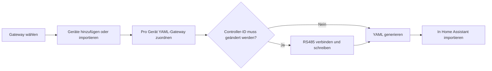

# EEDTOY – Benutzerhandbuch

**Deutsch · für EEDTOY v1.1.05 · Stand: November 2026**

EEDTOY ist ein Desktop-Konfigurator für unterstützte EnOcean-Geräte und ELTAKO-Series-14-Bussysteme. Er verwaltet Geräte und ihre Gateway-Zuordnung, importiert PCT14- und MiniSafe2-Daten und erzeugt eine YAML-Datei für die Home-Assistant-Integration **ELTAKO Sensors & Actuators**.

> **Sicherheit:** YAML erzeugen ist nicht gleichbedeutend mit Aktoren programmieren. Zum Schreiben von Controller-/Sender-IDs ist ein separater, ausdrücklich bestätigter Vorgang über den korrekten FAM14- bzw. FGW14-USB-RS485-Anschluss erforderlich. Vorher die vorhandene PCT14-Konfiguration sichern.

## Kapitel

1. [Installation und erster Start](installation.md)
2. [Gateways, COM-Ports und Base-IDs](gateways.md)
3. [Geräte hinzufügen und verwalten](devices.md)
4. [PCT14-Import und mehrere Bussysteme](pct14-import.md)
5. [MiniSafe2-Import](minisafe2-import.md)
6. [Controller-IDs und Sender-IDs schreiben](sender-ids.md)
7. [YAML erzeugen und in Home Assistant importieren](yaml-home-assistant.md)
8. [Projekte speichern und öffnen](projects.md)
9. [Praxisbeispiele FHK14 und FTS14EM](examples.md)
10. [Fehlerbehebung und FAQ](troubleshooting.md)

## Schnellstart

1. Windows-Installer aus den [GitHub Releases](https://github.com/DenisZirn/eedtoy/releases) installieren.
2. Unter **Gateway** Typ, COM-Port und Base-ID erkennen beziehungsweise überprüfen.
3. Unter **Geräte** ein Profil manuell anlegen oder PCT14/MiniSafe2 importieren.
4. Für jedes Gerät ein geeignetes **YAML-Gateway** wählen; ein Gerät wird nur unter einem Gateway exportiert.
5. Über **Projekt speichern unter …** den Projektstand sichern.
6. Mit **YAML generieren** die Vorschau öffnen. Hinweise auf noch zu schreibende Controller-IDs beachten.
7. Falls erforderlich, die Controller-IDs über den richtigen RS485-Bus [schreiben](sender-ids.md), das Projekt erneut speichern und YAML neu erzeugen.
8. Mit **Download** die Datei eltako_config.yaml speichern und in der Home-Assistant-Integration über **EEDTOY YAML importieren** einlesen.

## Wichtige Begriffe

| Begriff | Bedeutung |
| --- | --- |
| **Geräte-ID** | Kennung eines Sensors oder Aktors |
| **Sender-/Controller-ID** | Absenderkennung, von der ein Aktor Steuertelegramme akzeptieren soll |
| **FAM-USB-Base-ID** | Basis für Funk-Sender-IDs des FAM-USB |
| **FAM14-Bus-Base-ID** | Kennung des physischen Series-14-Bussystems |
| **YAML-Gateway** | Gateway, unter dem ein Gerät nach Home Assistant exportiert wird |
| **Projektdatei** | Lokal gespeicherter EEDTOY-Arbeitsstand; nicht identisch mit YAML |

Nicht jedes Geräteprofil bietet alle Funktionen. **Das Handbuch beschreibt v1.1.05 anhand des Quellcodes. Screenshots werden separat ergänzt.**

[Quellcode](https://github.com/DenisZirn/eedtoy) · [Versionshinweise](../../CHANGELOG.md) · [Fehler melden](https://github.com/DenisZirn/eedtoy/issues/new/choose)

> EEDTOY ist ein unabhängiges Projekt und kein offizielles Produkt der ELTAKO GmbH.
